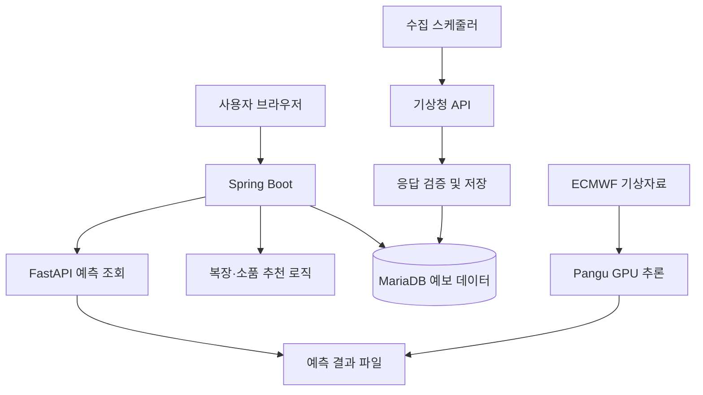

# Weather Mate

### 날씨를 확인하고, 오늘의 옷차림과 활동까지

기상청 예보 · AI 기온 예측 비교 · 날씨 기반 생활 정보

[프로젝트 소개](#프로젝트-소개) · [담당 기능](#담당-기능) · [핵심 구현](#핵심-구현-과정) · [실행 안내](#실행-안내)

---

## 프로젝트 소개

Weather Mate는 서울 지역의 기상청 예보와 AI 모델의 기온 예측을 비교하고, 날씨에 맞는 복장·소품과 생활 정보를 제공하는 웹서비스입니다. 기온뿐 아니라 강수·바람·습도·계절을 함께 고려하여 사용자가 일상에서 활용할 수 있는 정보를 보여줍니다.

| 항목 | 내용 |
| --- | --- |
| 프로젝트 유형 | 풀스택 개발 교육 과정 팀 프로젝트 |
| 개발 인원 | 6명 |
| 개발 시기 | 2026년 10월 · 팀 프로젝트 실작업 약 1주 |
| 주요 담당 | 백엔드 API, 기상청 연동, 예보 데이터 저장·조회, 수집 스케줄, 복장·소품 추천 로직 |
| 주요 조회 지역 | 서울특별시 25개 자치구 |

> 저장소 이름은 `weather-mate`이며, 기존 프로젝트 폴더와 패키지의 `weather-life` / `com.weatherlife` 명칭은 유지하고 있습니다. 아래 설명은 현재 저장소의 구현을 기준으로 합니다.

<!-- 실제 서비스 화면을 추가할 때 주석을 해제하세요.

-->

## 주요 기능

아래는 프로젝트 전체 기능이며, 개인 담당 범위는 다음 항목에 구분했습니다.

| 기능 | 설명 |
| --- | --- |
| 지역별 날씨 | 서울 자치구별 날짜·시각 기반 예보 조회 |
| AI 예측 비교 | Pangu-Weather 기온과 가까운 예보 시각의 기상청 기온을 함께 표시 |
| 복장·소품 추천 | 기온, 강수, 바람, 습도와 계절을 반영한 규칙 기반 추천 |
| 생활 정보 | 날씨 캐릭터, 활동 추천, 불쾌지수 및 빨래 관련 정보 |
| 예보 자동 수집 | 기상청 발표 일정에 맞춘 수집·갱신 및 지난 예보 정리 |
| AI 결과 자동 갱신 | ECMWF 자료 확인 후 Pangu GPU 추론을 수행하고 예측 결과 파일 갱신 |

**AI 모델은 기상 예측에 사용하며, 복장·소품은 날씨 조건과 점수 규칙으로 추천합니다.**

## 담당 기능

**기상 데이터를 수집·저장하고, 화면에서 사용할 날씨 및 생활 추천 API를 제공하는 백엔드 구현을 담당했습니다.**

| 영역 | 구현 내용 |
| --- | --- |
| 외부 API 연동 | 기상청 단기·중기예보 호출, 지역명과 좌표 매핑 |
| 데이터 처리 | 항목별 예보를 시간 단위로 묶어 저장하고, 발표 시각 기준으로 갱신 |
| 조회 API | 지역·날짜·시각별 날씨 및 복장·소품 추천 응답 구성 |
| 스케줄 관리 | 서울 25개 구 대표 격자 수집, 과거 예보 정리 |
| 추천 로직 | 날씨 조건별 착장·소품 선택, 봄·가을의 계절 가중치 보완 |
| AI 서버 연동 | 별도 예측 서버의 응답을 웹서비스 API로 연결하고 오류·응답 지연 처리 |

## 시스템 구성

기상청 예보는 수집 후 MariaDB에서 조회합니다. AI 예측은 별도 Python 서비스가 결과 파일을 생성하고, Spring Boot가 FastAPI를 호출하여 화면에 필요한 기온 데이터를 전달합니다.

- **날씨·복장 조회:** 저장된 예보를 사용하여 조회 요청마다 기상청을 다시 호출하지 않도록 구성했습니다. 원본 예보를 직접 조회하는 별도 API도 있습니다.
- **AI 조회:** Spring Boot에서 별도 AI API를 호출합니다. 이 결과를 Spring 측 DB에 저장하거나 캐시하지 않습니다.
- **AI 추론:** API 요청 처리와 분리된 갱신 작업에서 수행합니다.

## 핵심 구현 과정

### 1. 기상청 응답을 시간별 데이터로 통합

기상청 단기예보는 같은 시각의 기온·습도·풍속 등이 각각 다른 항목으로 전달됩니다. 이를 **격자 좌표와 예보 시각** 기준으로 묶어 저장하고, 지역·날짜·시각별 조회에 사용하도록 구성했습니다.

- `(grid_x, grid_y, forecast_at)`에 유일 제약을 설정하여 같은 격자·시각의 중복 저장을 방지합니다.
- 기존 데이터보다 **발표 시각이 최신인 경우** 갱신합니다.
- 필수 기상 항목의 값과 범위, 응답 누락 여부를 확인합니다.
- 일부 항목만 수신된 데이터가 기존의 유효한 예보를 덮어쓰지 않도록 처리합니다.
- 외부 API 응답을 기다리는 동안 DB 트랜잭션을 유지하지 않고, 검증된 데이터의 저장 단계에 트랜잭션을 적용합니다.

[수집·검증·저장 코드](weather-life/src/main/java/com/weatherlife/service/WeatherCollectionService.java) · [예보 엔티티](weather-life/src/main/java/com/weatherlife/entity/HourlyForecast.java)

### 2. 수집 주기와 조회 요청 분리

서울 25개 구의 대표 격자를 기준으로 예보를 수집하며, 격자가 겹치는 지역은 같은 수집 단위로 처리합니다. 자동 수집을 활성화하면 한국 시각 기준 **02·05·08·11·14·17·20·23시 20분**에 갱신합니다.

수집과 조회를 분리하여 날씨 화면과 복장 추천이 같은 저장 데이터를 활용하도록 했습니다. 지난 예보는 정리하고, 초기 데이터 적재나 점검을 위한 수동 수집 API도 제공합니다.

[서울 지역 수집 코드](weather-life/src/main/java/com/weatherlife/service/SeoulWeatherCollectionService.java) · [스케줄러](weather-life/src/main/java/com/weatherlife/scheduler/WeatherCollectScheduler.java)

### 3. 날씨를 우선하고 계절을 보조하는 복장 추천

계절만으로 옷을 고르면 따뜻한 가을이나 추운 봄에 맞지 않는 결과가 나올 수 있습니다. 기온 적합도를 중심으로 강수·바람 조건을 반영하고, 계절은 보조 점수로 사용하도록 구성했습니다.

| 조건 | 추천에 반영하는 방식 |
| --- | --- |
| 기온 | 착장의 적정 기온 및 허용 범위와 비교 |
| 강수 | 우천용 착장 가점 및 비에 적합하지 않은 항목 감점 |
| 바람 | 방풍 관련 태그와 바람에 민감한 착장 여부 반영 |
| 계절·습도 | 봄·가을의 온화한 날씨와 덥고 습한 조건을 구분하여 보정 |

[복장 추천 코드](weather-life/src/main/java/com/weatherlife/service/OutfitService.java) · [소품 추천 코드](weather-life/src/main/java/com/weatherlife/service/AccessoryService.java)

### 4. AI 예측과 기상청 예보의 비교 시각 정렬

AI 응답의 `validTimeKst`와 기상청 예보의 `forecastAt`을 기준으로 비교합니다. AI 예측 시각의 UTC 오프셋을 해석하고, 기상청 예보 시각은 한국 시각으로 처리하여 가장 가까운 예보를 찾습니다. 화면에는 비교에 사용한 시각과 차이를 표시합니다.

현재 AI 서비스는 **오늘·내일·모레 오전 9시의 예측값을 하루 1개씩** 제공합니다. 하루 평균·최고·최저 기온이나 시간별 AI 예보를 의미하지 않습니다.

Spring Boot는 AI 서버 호출 시 연결 제한 3초, 읽기 제한 15초를 적용하고, 연결 실패·지연은 `503`, 잘못된 외부 응답은 `502`로 처리합니다. 인증키는 서버에서 전달합니다.

[AI 연동 코드](weather-life/src/main/java/com/weatherlife/service/AiForecastService.java) · [화면 비교 로직](weather-life/src/main/resources/static/js/main.js)

## AI 모델 및 데이터 연동

| 구성 | 사용 목적 |
| --- | --- |
| 기상청 API | 단기·중기예보 조회 |
| ECMWF Open Data | Pangu 예측에 사용할 초기 기상자료 수집 |
| Pangu-Weather | 사전 학습된 24시간 ONNX 모델을 이용한 기상 추론 |
| ONNX Runtime GPU | CUDA 환경에서 모델 실행 |
| FastAPI | 저장된 예측 결과를 좌표 기반 API로 제공 |

자동 갱신기는 기본 10분 간격으로 새 기준일의 자료가 필요한지 확인합니다. 같은 초기자료로 오늘부터 3일의 오전 9시 값을 예측하는 정책이므로, **10분마다 새 예측을 생성하는 것은 아닙니다.** 통상 기준일마다 한 번 갱신하며, 추론이 성공한 결과만 공개합니다.

AI 모델을 새로 학습한 서비스가 아니라 **사전 학습 모델의 추론 결과를 웹서비스에 연동한 프로젝트**입니다. 모델 비교용 노트북은 서비스 실행 코드와 별도로 포함되어 있습니다.

[AI 서버·GPU 실행 안내](ai-service/README.md) · [예측 파이프라인](ai-service/pangu_service/pipeline.py) · [모델 비교 노트북](notebooks/Weather_AI_Model_Comparison.ipynb)

## 기술 스택

| 구분 | 기술 |
| --- | --- |
| 언어 | Java 21, Python, JavaScript, HTML, CSS |
| 백엔드 | Spring Boot, Spring MVC, Spring Data JPA, RestClient, Bean Validation, Lombok |
| 화면 | Thymeleaf, JavaScript |
| 데이터베이스 | MariaDB |
| AI 서비스 | FastAPI, Uvicorn, Pangu-Weather, ONNX Runtime GPU |
| 기상자료 처리 | NumPy, ecCodes, ECMWF Open Data 클라이언트 |
| 외부 데이터 | 기상청 단기·중기예보 API, ECMWF 기상자료 |
| 개발 환경·빌드 | Windows 11, Docker, Gradle |
| 형상 관리·협업 | Git, GitHub, Slack |
| 테스트 구성 | JUnit, Spring Boot Test, H2, Python 테스트 코드 |

## 주요 API

| 메서드 | 경로 | 기능 |
| --- | --- | --- |
| GET | `/api/weather/short?gu=영등포구&date=YYYY-MM-DD` | 지정 날짜의 시간별 날씨 |
| GET | `/api/weather/hour?gu=영등포구&at=YYYY-MM-DDTHH:mm:ss` | 지정 시각 날씨 |
| GET | `/api/outfits/by-date?gu=영등포구&date=YYYY-MM-DD` | 날짜별 복장·소품 추천 |
| GET | `/api/outfits/by-hour?gu=영등포구&at=YYYY-MM-DDTHH:mm:ss` | 시각별 복장·소품 추천 |
| GET | `/api/weather/ai?gu=영등포구` | AI 예측 서버의 3일 기온 |
| POST | `/api/internal/weather/collect-all` | 서울 대표 격자 예보 수동 수집 |
| POST | `/api/internal/weather/cleanup` | 지난 예보 정리 |

수동 수집 API는 설정이 활성화된 경우 사용할 수 있습니다. 상세 파라미터와 환경 설정은 [백엔드 안내](weather-life/README.md)를 참고하세요.

## 실행 안내

| 폴더 | 내용 |
| --- | --- |
| [`weather-life/`](weather-life/) | Spring Boot 백엔드 및 Thymeleaf 화면 |
| [`ai-service/`](ai-service/) | FastAPI 서버, 기상자료 수집 및 Pangu 추론·자동 갱신 |
| [`weather-unit-main/`](weather-unit-main/) | 날씨 캐릭터·착장·활동 리소스와 제작 도구 |
| [`notebooks/`](notebooks/) | 모델 비교 분석 노트북 |

1. **웹서비스:** JDK 21, MariaDB 및 기상청 API 인증 정보를 준비하고 [백엔드 안내](weather-life/README.md)에 따라 실행합니다.
2. **AI 예측:** Python 3.11과 CUDA 지원 GPU 환경에서 [AI 서비스 안내](ai-service/README.md)에 따라 모델·의존성을 준비하고 API 서버와 자동 갱신기를 실행합니다.
3. **서비스 연결:** Spring Boot 실행 환경에 `AI_FORECAST_BASE_URL`과 `AI_FORECAST_API_KEY`를 설정합니다.
4. **예보 적재:** 수동 수집을 실행하거나 `weather.collection.enabled=true`로 자동 수집을 활성화합니다.

AI 서비스는 최초 추론 결과가 준비되어야 예측을 반환합니다. 로컬 PC가 꺼져 있거나 절전 상태이면 해당 PC의 API·자동 갱신도 중단됩니다. 테스트 코드의 검증과 실제 GPU 추론 성공 여부는 별도로 확인해야 합니다.

<!-- 실제 화면을 준비한 뒤 아래 주석을 해제하세요.
## 주요 화면

### AI와 기상청 예보 비교

### 복장·소품 추천

### 생활 정보

-->
